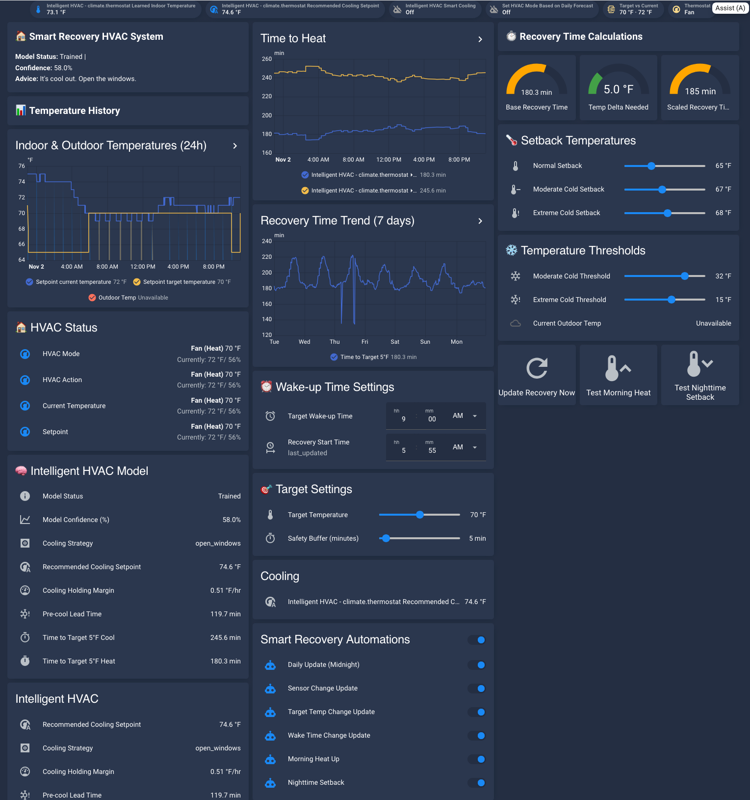

<h1 align="center">🏠 Intelligent HVAC</h1>

<p align="center">
  <b>Your thermostat follows a schedule. Your house follows physics.<br>
  Intelligent HVAC learns the physics.</b>
</p>

<p align="center">
  
  
  
  
</p>

<p align="center">
  
</p>

## 🌅 Imagine waking up and it's already warm

You said you wanted **70°F at 7:00 AM**. That's all you did.

Overnight the house relaxed to a cool setback — you slept comfortably and didn't pay to heat an empty-feeling house all night. Then, at exactly the right minute (not "5 AM, just in case"), the heat came on, because Intelligent HVAC *knows how long **your** house takes to climb from 65°F to 70°F at today's outdoor temperature*. You wake up to 70°F.

In summer it flips: on a cool night it tells you to **open the windows** and lets the AC rest, then holds comfort early on mornings that are about to turn hot. Same brain, different season — and a daily forecast check switches the mode for you.

## 🤔 Why not just use the thermostat's "learning" mode?

"Smart" and "learning" thermostats mostly learn *your schedule*, and what they learn lives in someone else's cloud. Logins get blocked, APIs go away, and what they know about your house is never exposed to you.

Intelligent HVAC learns something different and more useful — **your house's physics** — and keeps all of it local, visible, and usable in your own automations.

---

Intelligent HVAC is a Home Assistant custom integration that learns a thermal model of your specific home from your own recorder history — how fast it heats, how fast it cools, how quickly it leaks heat outdoors — and turns that model into sensors and smart setpoints.

No cloud. No guesswork. No hard-coded "start heating at 6 AM". Just *"it takes this house 38 minutes to gain 5°F at the current outdoor temperature, so start at 6:22."*

## ✨ What it does

- 🧠 **Learns from the history you already have.** Pulls as much recorder history as exists and starts learning immediately — no two-week waiting period.
- 📐 **Models four kinds of thermal behaviour:** active heating, active cooling, passive heat loss, and passive heat gain.
- 🎯 **Answers the questions automations care about:** *How long to recover 5°F? Can the AC keep up today? When should I start pre-cooling?*
- 🌬️ **Knows when to do nothing.** Cool night and the house is already shedding heat? It tells you to open the windows or coast instead of burning AC.
- 📈 **Honest about uncertainty.** A composite confidence score (fit, sample count, temperature coverage) tells you how much to trust it.
- 🔌 **Works with Ecobee and HomeKit thermostats** — anything exposing `hvac_action` and `current_temperature`. See [COMPATIBILITY.md](COMPATIBILITY.md).
- 🏡 **Stays local.** Everything runs inside Home Assistant.

## 🚀 Installation

Two parts: the **integration** (learns the model, provides sensors) and the **comfort package** (the helpers and automations that act on it — wake-up time, setbacks, morning heat-up). You want both.

### 1. The integration

**HACS (custom repository):** HACS → ⋮ → *Custom repositories* → `https://github.com/JHenzi/IntelligentHVAC`, category *Integration* → install → restart.

**Manual:** copy this repo to `config/custom_components/intelligent_hvac/` → restart.

Then **Settings → Devices & Services → Add Integration → Intelligent HVAC**:

| Option | Description | Default |
|---|---|---|
| Climate entity | Your thermostat | — |
| Indoor temperature sensors | One or more, optionally weighted | — |
| Outdoor temperature source | Sensor, climate, or weather entity | — |
| Training days | History to learn from | 30 |
| Sampling interval | Canonical timestep | 5 min |
| Comfort cooling temp | Target when cooling | 72°F |
| Night setback temp | Relaxed overnight target | 74°F |
| Max pre-cool offset | How far below comfort pre-cooling may go | 2°F |
| Pre-cool lead time | Minutes of lead | 60 |
| Night window | Start / end | 22:00 / 07:00 |

### 2. The comfort package

Adds the helpers and automations. Five minutes: [packages/README.md](packages/README.md).

### 3. The dashboard (optional, recommended)

Core cards only — [dashboards/README.md](dashboards/README.md).

> **Heads up:** the model needs some history to be trustworthy. Check *Thermal Model Confidence* — below ~50% treat the output as a preview.

## 📊 Sensors

| Sensor | Tells you |
|---|---|
| Thermal Model Status | Whether the model is trained |
| Thermal Model Confidence | How much to trust the model (0–100%) |
| Learned Indoor Temperature | Composite of your indoor sensors |
| Heating Rate at 32°F | How fast the home heats in the cold |
| Cooling Rate at 75°F | How fast the home cools |
| Passive Decay Rate at 32°F | Heat loss with the HVAC off |
| Passive Gain Rate at 75°F | Heat gain with the HVAC off |
| Time to Target 5°F Heat / Cool | Minutes to move 5°F at current conditions |
| Time to Drop 5°F Passive | How long the house takes to drift down on its own |
| Cooling Holding Margin | Net cooling headroom in °F/hr — can the AC outrun the heat load? |
| Pre-cool Lead Time | Minutes needed to get back to comfort |
| Recommended Cooling Setpoint | What Intelligent HVAC wants the thermostat at |
| Cooling Strategy | *Why* — see below |

## 🧊 Smart cooling (summer)

`sensor.cooling_strategy` explains each decision in plain terms:

| Strategy | Meaning |
|---|---|
| `open_windows` | Outdoor air is favourable; open up and back off the AC |
| `coast_no_cooling` | Let the house drift naturally |
| `anticipate_warming` | Cool now, hot later — hold comfort to stay ahead |
| `night_setback` | Cooling is easy; relax overnight |
| `comfort_hold` | Hold the normal target |
| `recover_comfort` | House drifted warm; bring it back |
| `start_precool` / `precool_now` | Start early so cooling doesn't fall behind |

The logic lives in the integration, so the automation stays trivial (included in the comfort package):

```yaml
alias: Intelligent HVAC Smart Cooling
triggers:
  - trigger: homeassistant
    event: start
  - trigger: time_pattern
    minutes: /15
conditions:
  - condition: state
    entity_id: climate.thermostat
    state: [cool, heat_cool]
actions:
  - action: intelligent_hvac.apply_smart_cooling_setpoint
    data:
      climate_entity: climate.thermostat
```

Full details: [documentation/SMART_COOLING.md](documentation/SMART_COOLING.md).

## 🔧 Services

| Service | Purpose |
|---|---|
| `intelligent_hvac.apply_smart_cooling_setpoint` | Compute and apply the recommended cooling setpoint (cooling-safe only; never switches HVAC mode) |
| `intelligent_hvac.force_update` | Re-fetch history and relearn now |

## 🔬 How it works

History → uniform resampling → thermal segments → linear regression → sensors.
Read [documentation/ARCHITECTURE.md](documentation/ARCHITECTURE.md) for the layered design, segment definitions and confidence scoring.

## 🗺️ Roadmap

- Native helper entities so the comfort package becomes optional
- Heating-season guidance to match the cooling side
- HACS default-repository submission

Feedback and issues very welcome: <https://github.com/JHenzi/IntelligentHVAC/issues>

## 🤝 Contributing

See [documentation/DEVELOPMENT.md](documentation/DEVELOPMENT.md).

## 📄 License

[GPL-3.0](LICENSE)
