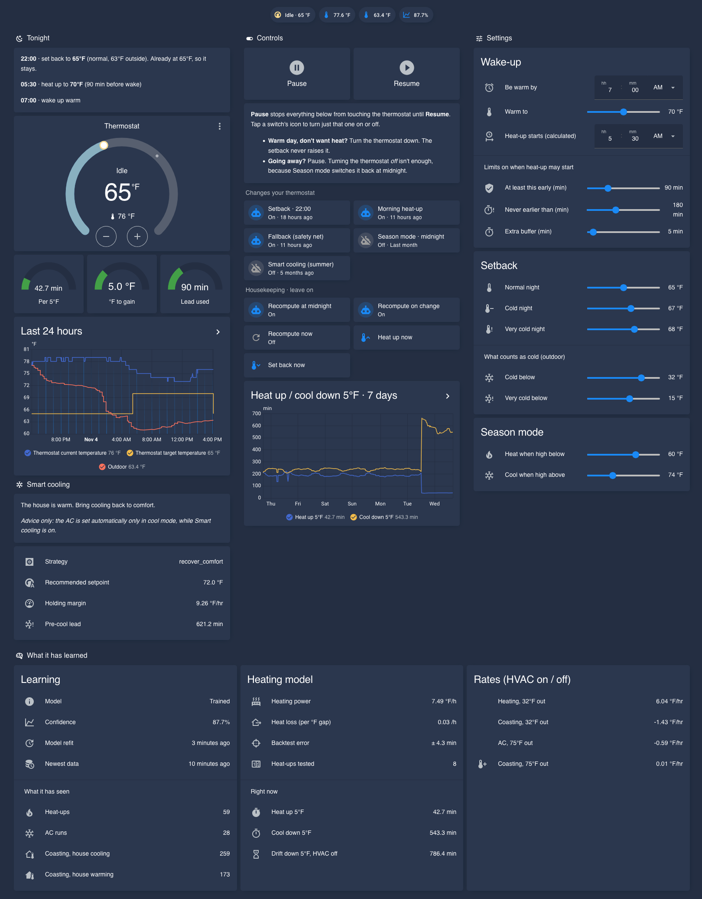

# Dashboard

Built with **core cards only**, so no HACS frontend cards are required.

## Install

Requires the integration and the [comfort package](../packages/README.md), which provides the helpers and automations the dashboard shows.

1. **Settings → Dashboards → Add dashboard** → *New dashboard from scratch* → open it.
2. **⋮ → Edit dashboard → ⋮ → Raw configuration editor**.
3. Replace everything with the contents of [`intelligent_hvac_dashboard.yaml`](intelligent_hvac_dashboard.yaml) and save.
4. If your entity IDs differ from the defaults, find & replace them:

| Default | What it is |
|---|---|
| `climate.thermostat` | your thermostat |
| `sensor.intelligent_hvac_*` | the integration's sensors (check **Developer Tools → States**) |
| `sensor.outdoor_temperature_most_recent` | created by the comfort package |

## Using it

The view is split into sections:

| Section | What it's for |
|---|---|
| **Tonight** | The plan as a timeline: setback temperature and why, when heat-up starts, wake-up. It shows when a step is switched off, when the setpoint is already below the setback (the setback only ever lowers), and when the thermostat isn't in heat. The gauges show the model's minutes per 5°F, the degrees to gain, and the lead actually used. |
| **Controls** | **Pause / Resume** stop or restart everything that changes your thermostat. Below that is each automation with a one-line note on what it does, when it last ran, and its own switch. *Housekeeping* holds the recompute automations (leave them on) and confirm-first *Heat up now* / *Set back now* buttons. |
| **Settings** | Wake-up time and target, limits on when heat-up may start, setback temperatures and what counts as cold, and the season-switch thresholds |
| **What it has learned** | When the model last refit, the newest data it used, what it has seen (heat-ups, AC runs, coasting), heating power, heat loss, backtest error, every model sensor, and 24-hour / 7-day graphs |
| **Smart cooling** | Summer advice and the cooling sensors |

Common situations:

- **Want the thermostat to yourself:** *Pause*.
- **Warm day, don't want heat:** turn the thermostat down. The setback won't raise it.
- **Going away:** *Pause*. Turning the thermostat off isn't enough, because *Season mode* switches it back at midnight.

> Heating is only learned on nights the heat actually runs. On mild nights the *coasting* count still grows, because the house losing heat with the HVAC off is how heat loss is learned.
